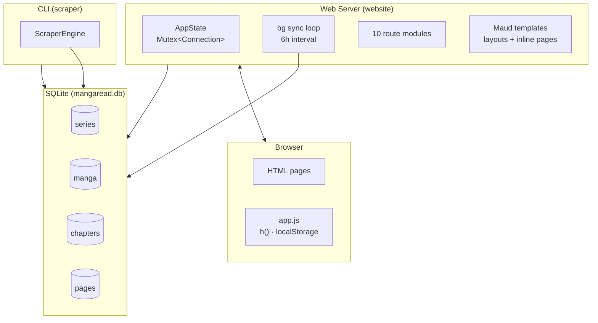

# MangaRead

Scrapes chapters from third-party manga sites, merges them into series, and serves them through a local web interface. Bookmarks, reading progress, auto-sync.

## Quick Start

```bash
docker compose up --build
```

Open http://localhost:3000. SQLite database lives in a named volume.

Development without Docker: see [Running without Docker](#running-without-docker).

### Screenshots

| Home | Series List |
|------|-------------|
|  |  |

| Series Details | Chapter Reader |
|----------------|----------------|
|  |  |

## Architecture



Three crates, one workspace:

| Crate | What it does |
|-------|-------------|
| `mangaread-core` | Domain types, SQLite repository (`db.rs`), services, title normalization |
| `scraper` | `SiteAdapter` trait + per-site implementations. CLI binary + library |
| `website` | Axum web server. Routes in `routes/`, templates in `templates/`, static assets |

### Design notes

- **Unified series**: Manga from different sources link to one `series` by normalized title. Chapters merge across sources; the source with the most chapters wins on duplicates.
- **Auto-sync**: On startup, scans all sources, finds stale entries (>2h), syncs chapters in parallel (up to 3 chromedriver sessions on OS threads). Repeats every 6 hours.
- **rusqlite is `!Sync`**: Each scraper thread opens its own connection. Main `AppState` wraps its connection in `Mutex<Connection>`.
- **Client-side state**: Bookmarks, reading progress, source filters — all `localStorage`. No accounts.
- **WebDriver**: Uses system-installed chromedriver (`/usr/bin/chromedriver`), offline mode. Chromium flags from `CHROMIUM_FLAGS` env var.

### Routes

| Route | Handler | What it does |
|-------|---------|--------------|
| `GET /` | `home` | Landing page: stats + 30 recent chapters |
| `GET /series` | `series_list` | Paginated grid, `?q=` search |
| `GET /series/{id}` | `series_detail` | Merged chapters, source filter, triggers sync if stale |
| `GET /bookmarks` | `bookmarks_page` | Client-side shell, JS fills from localStorage |
| `GET /source/{source}` | `source_list` | Manga grid for one source |
| `GET /manga/{id}` | `manga_detail` | Redirects to series (legacy) |
| `GET /read/{m}/{ch}` | `chapter_reader` | Reader with prev/next nav, auto-reload if unsynced |
| `GET /api/check-manga/{id}` | `check_manga` | Chapter count (lightweight) |
| `GET /api/check-chapter/{id}` | `check_chapter` | Page count (lightweight) |
| `GET /api/sync-status` | `sync_status` | Loop progress + error drain |
| `POST /api/sync-manga/{id}` | `sync_manga` | Trigger background manga sync |
| `GET /api/progress-series` | `progress_series` | Series info for "Continue Reading" |
| `GET /health` | `health` | Docker liveness probe |

### Client-side bits

All state in `localStorage`. DOM built with `h(tag, props, ...children)`.

- **Reading progress**: ○ unread, ▶ started, ✓ finished. Tracks pages via `IntersectionObserver`, saves on `beforeunload`
- **Source filters**: Checkboxes above chapter list toggle visibility per source
- **Reader**: Click left/right third of screen for prev/next. Arrow keys work too. Top bar shows page indicator when you scroll up.
- **Bookmarks**: Page is a shell, JS reads from localStorage
- **Continue Reading**: Cards on home page (170x227px, `background-size: cover`)

## Docker

```bash
docker compose up --build -d
docker compose logs -f
docker compose down
```

Requires chromium/chromedriver in the image. Container needs `SYS_ADMIN` capability and 2GB memory limit.

**Environment variables** (set in docker-compose.yml):

| Variable | Default | What it does |
|----------|---------|-------------|
| `MANGAREAD_DB` | `/app/data/mangaread.db` | SQLite path |
| `CHROMIUM_FLAGS` | `--no-sandbox --disable-dev-shm-usage --disable-gpu --headless` | Chromium args |
| `RUST_LOG` | `info` | Log level |
| `SITE_TITLE` | `MangaRead` | Site title |
| `SITE_COLOR` | `#a78bfa` | Accent color |
| `SITE_BG` | `#1a1b2e` | Background color |

## Running without Docker

**Prerequisites**: Rust 1.82+, chromedriver on `PATH`.

```bash
cargo run -p website
```

Open http://localhost:3000. The server starts a background sync loop that discovers manga and fetches chapters automatically — no manual scan needed.

## CLI Reference

These are optional — the server's background sync loop handles everything automatically. Use them for one-off debugging.

### `cargo run -p manga-scraper scan`
Visits each source's index page, finds manga listings, upserts to DB. Auto-links manga to series by normalized title.

### `cargo run -p manga-scraper sync-manga <id>`
Visits a manga's detail page, gets chapter list, upserts chapters. Updates series title from the detail page.

### `cargo run -p manga-scraper sync-chapter <id>`
Visits a chapter's reader page, extracts page image URLs, upserts pages.

## Source Adapters

| Adapter | Site | What it handles |
|---------|------|----------------|
| `DemonicscansAdapter` | demonicscans.org | Chapters, pages |
| `ManhuaplusAdapter` | manhuaplus.top | Chapters, pages |

New source: implement `SiteAdapter` in `scraper/src/adapters/`, register in `scraper_helper.rs` and `scraper/src/main.rs`.

## Project Structure

```
mangaread/
├── mangaread-core/         # Domain models, DB, services
│   └── src/
│       ├── domain/         # series.rs, manga.rs, chapter.rs, page.rs, source.rs, title.rs
│       ├── db.rs           # SQLite repository (one big file)
│       └── service/        # series merging logic
├── scraper/                # Scraping library + CLI
│   └── src/
│       ├── adapter.rs      # SiteAdapter trait
│       ├── engine.rs       # ScraperEngine orchestrator
│       ├── adapters/       # demonicscans.rs, manhuaplus.rs, helpers.rs
│       └── main.rs         # CLI entrypoint
├── website/                # Axum web server
│   └── src/
│       ├── main.rs         # AppState, routes, server startup
│       ├── scraper_helper  # build_engine(), create_webdriver(), start_sync_loop()
│       ├── routes/         # 10 route modules
│       ├── templates/      # layout.rs (base_layout, reader_layout, error_layout)
│       └── static/         # Bulma vendor, theme/reader CSS, JS, fonts
├── docs/architecture/      # Architecture documentation
├── Dockerfile
└── docker-compose.yml
```

## Database

SQLite with WAL mode. Four tables:

- **series**: Unified title, groups manga from multiple sources
- **manga**: Per-source entries linked to a series
- **chapters**: Chapter metadata, linked to a manga
- **pages**: Page image URLs, linked to a chapter

All inserts use `ON CONFLICT ... DO UPDATE` (upsert). Safe to re-run.

## Architecture

See [docs/architecture/README.md](docs/architecture/README.md) for a deep dive into the crate structure, data model, scraping pipeline, sync loop, and design rationale.

## License

Training project — use freely.
