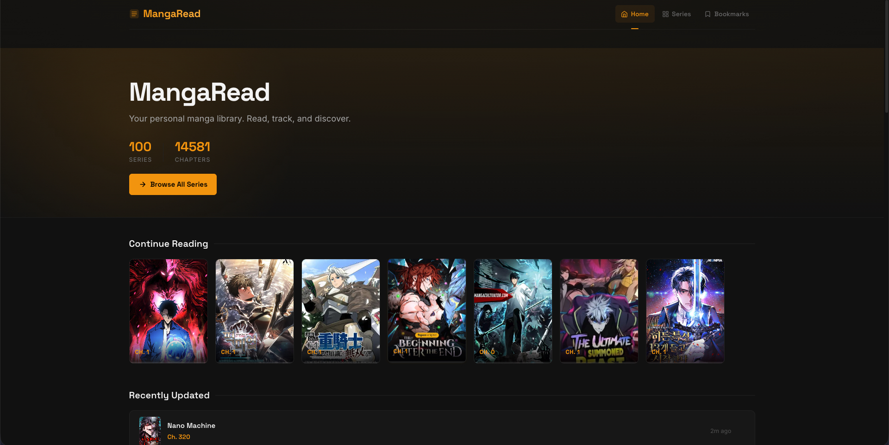
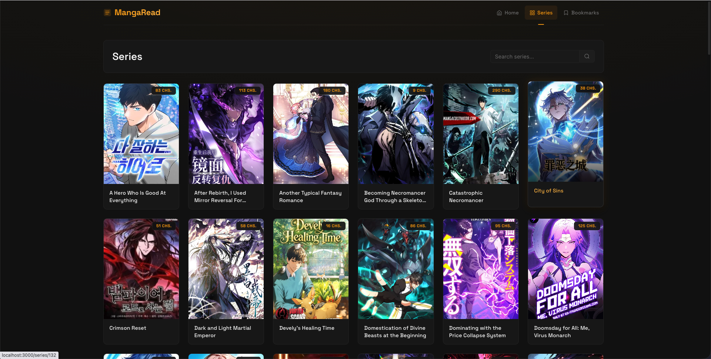
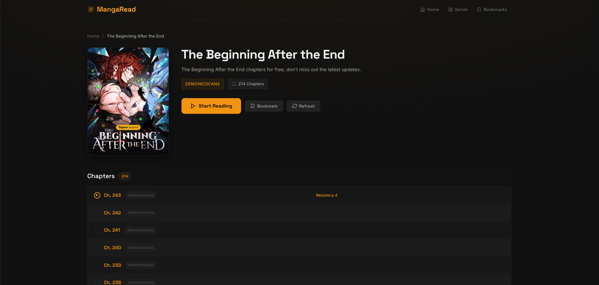
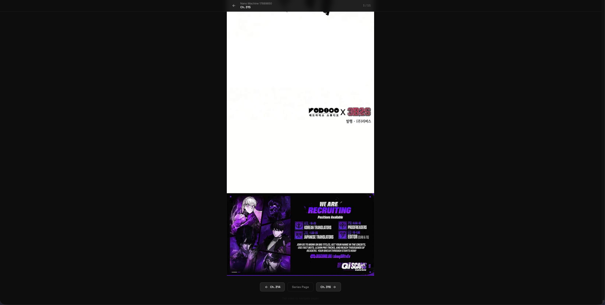

# MangaRead

A self-hosted manga library for you and the people you share it with. It fetches chapters from supported sites, merges the same title from several sources into one series, and serves a fast reader with accounts, synced progress, and bookmarks.

One Docker container, one SQLite file, sized for 1–20 readers. Runs on a Raspberry Pi 4.

> **Content notice:** chapters come from third-party sites. Run MangaRead for yourself and people you know. Hosting it as a public site redistributes other people's work and invites takedowns.

## Install

```bash
curl -O https://raw.githubusercontent.com/DevYatsu/mangareader/master/compose.yaml
docker compose up -d
docker compose logs mangaread | grep "setup token"
```

1. Open `http://localhost:3000/setup`.
2. Paste the setup token from the log and create the admin account. Until you do, every page redirects to `/setup`, so nobody else can claim the instance.
3. Set up email at `/admin/email` (setup takes you there). Readers sign up with an emailed link, so **sign-up stays closed until SMTP works**. "Send test email" checks the settings.
4. Optional: set the title, colors, and homepage at `/admin/branding`.

The first sync starts on boot and runs every 6 hours. A large source takes a while on first run.

Before exposing it beyond your LAN, put it behind HTTPS and set `MANGAREAD_BASE_URL` and `MANGAREAD_COOKIE_SECURE=1` in `compose.yaml`.

### Screenshots

| Home | Series List |
|------|-------------|
|  |  |

| Series Details | Chapter Reader |
|----------------|----------------|
|  |  |

## Accounts and roles

| Level | How you get it | Can |
|---|---|---|
| Visitor | Not logged in | Read everything. Progress stays in the browser. |
| User | Signs up by email link, or Google/GitHub/Discord | Progress, bookmarks, and notes synced across devices. |
| Moderator | Promoted by an admin | Will moderate chapter comments once they ship. No access to site settings or the catalog. |
| Admin | `/setup`, or promoted by an admin | Everything under `/admin`: branding, email, users (roles, bans, reset links). |

- Sign-up never reveals whether an address already has an account.
- Sign-up links last 24 hours and reset links 1 hour. Both are single-use and stored only as hashes.
- Each address gets at most 3 emails per hour, and each IP at most 10 requests per hour.
- The last admin can never be demoted or banned. Every role change and ban is logged.
- Without SMTP, an admin can allow sign-up without verification (`/admin/email`, off by default). Anyone can then create accounts with any address.

## Configuration

Branding and email are set in `/admin` and take effect without a restart. Environment variables are boot defaults; see [`.env.example`](.env.example).

| Variable | Default | Purpose |
|---|---|---|
| `MANGAREAD_DB` | `mangaread.db` | SQLite path (`/app/data/mangaread.db` in Docker) |
| `MANGAREAD_CACHE_DIR` | `cache/` beside the database | Reader image cache (`/app/data/cache` in Docker); size cap set in Admin → Sources |
| `MANGAREAD_BASE_URL` | `http://localhost:3000` | Public URL for emailed links and OAuth callbacks |
| `MANGAREAD_COOKIE_SECURE` | unset | `1` behind HTTPS |
| `MANGAREAD_TRUST_PROXY` | unset | `1` only behind a proxy that sets `X-Forwarded-For` |
| `SMTP_URL`, `SMTP_FROM` | unset | Email defaults; `/admin/email` overrides |
| `MANGAREAD_OAUTH_{GOOGLE,GITHUB,DISCORD}_{ID,SECRET}` | unset | Enables that login button |
| `SITE_TITLE`, `SITE_COLOR`, `SITE_BG` | `MangaRead`, `#f59e0b`, `#131210` | Branding defaults; `/admin/branding` overrides |
| `CHROMIUM_FLAGS` | `--no-sandbox --disable-dev-shm-usage --disable-gpu --headless` | Chromium args for scraping |
| `RUST_LOG` | `info` | Log level |

**Resources:** each sync runs up to 3 headless Chromium sessions, so give the container about 2 GB of RAM. Chromium's sandbox needs `SYS_ADMIN`; a Chrome seccomp profile is the stricter alternative.

**Backups:** everything lives in the `mangaread_data` volume. Stop the container, then copy `mangaread.db` (with its `-wal` and `-shm` files if present).

## Development

Prerequisites: Rust 1.88+ and `chromedriver` on `PATH`.

```bash
cargo run -p website          # http://localhost:3000; prints a setup token on a fresh DB
cargo test --workspace
docker compose -f compose.build.yaml up --build   # build the image from source
```

Three crates, one workspace:

| Crate | What it does |
|-------|-------------|
| `mangaread-core` | Domain types, SQLite repository (`db.rs`), series merging, title normalization |
| `scraper` | `SiteAdapter` trait, per-site adapters, and a debugging CLI |
| `website` | Axum server: routes in `routes/`, Maud templates in `templates/`, Bulma + vanilla JS in `static/` |

Route tests drive the real router in-process over an in-memory database (`website/src/test_support.rs`). Outbound mail goes through the `Mailer` trait, which tests replace with an in-memory recorder.

Design specs and implementation plans live in [`docs/superpowers/`](docs/superpowers/). See [`docs/architecture/README.md`](docs/architecture/README.md) for the data model, scraping pipeline, and sync loop.

### Sources

| Adapter | Site |
|---------|------|
| `DemonicscansAdapter` | demonicscans.org |
| `ManhuaplusAdapter` | manhuaplus.top |

To add one, implement `SiteAdapter` in `scraper/src/adapters/` and register it in `website/src/scraper_helper.rs` and `scraper/src/main.rs`.

### Scraper CLI

The server syncs on its own; these commands are for debugging.

```bash
cargo run -p manga-scraper scan                 # discover manga on every source
cargo run -p manga-scraper sync-manga <id>      # fetch one manga's chapter list
cargo run -p manga-scraper sync-chapter <id>    # fetch one chapter's page URLs
```

## License

Training project — use freely.
