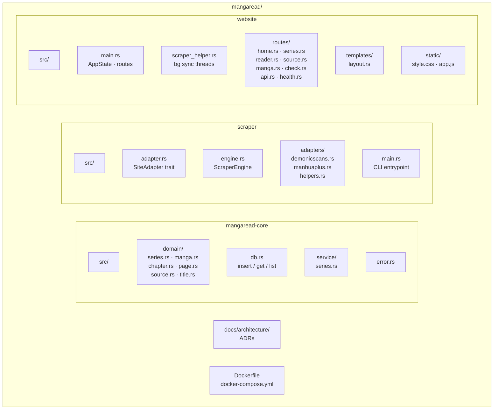

# MangaRead

Offline manga reader — scrapes chapters from third-party sites, merges them into unified series, and serves them through a local web interface with bookmarking and reading progress tracking.

## Architecture

```mermaid
flowchart LR
    subgraph CLI["CLI (scraper)"]
        SCR[ScraperEngine<br/>+ adapters]
    end
    subgraph WEB["Web Server (website)"]
        BG[bg sync thread<br/>chromedriver session]
        ROUTES[GET /series<br/>GET /read/{m}/{ch}<br/>...]
    end
    subgraph BROWSER["Browser"]
        HTML[HTML pages]
        JS[app.js<br/>localStorage]
    end
    subgraph DB["SQLite (mangaread.db)"]
        S[(series)]
        M[(manga)]
        C[(chapters)]
        P[(pages)]
    end
    CLI --> DB
    WEB --> DB
    WEB <--> BROWSER
    SCR --> DB
    BG --> DB
```

**Three crates** in a Cargo workspace:

| Crate | Role |
|-------|------|
| `mangaread-core` | Domain types, SQLite schema, repositories, services |
| `scraper` | CLI binary + library. `SiteAdapter` trait + implementations for each source site |
| `website` | Axum web server. Routes, templates, background scraper threads |

### Key design decisions

- **Unified series**: Manga from different source sites are linked to a single `series` by normalized title. Chapters from all sources are merged; the preferred source is used where available.
- **Auto-sync loop**: On startup, a background loop scans all sources for manga listings, then syncs their chapters in parallel (up to 3 concurrent chromedriver sessions). Each session opens its own driver and DB connection, then quits when done. The loop repeats every 6 hours, re-syncing stale entries (>2h since last sync).
- **Only series with chapters are shown**: The frontend filters out series with zero chapters, so you only see manga that have been fully fetched.
- **Client-side state**: Bookmarks, reading progress (current page), source preferences — all stored in `localStorage`. No user accounts.

## Quick Start

```bash
# 1. Scan source sites for manga listings
cargo run -p manga-scraper scan

# 2. Sync a specific manga's chapters (optional — website can do this on demand)
cargo run -p manga-scraper sync-manga 1

# 3. Start the web server
cargo run -p website

# 4. Open http://localhost:3000
```

The website will automatically sync chapters and pages when you visit a series or chapter that has no data yet.

## Docker

```bash
docker compose up --build
```

Opens on http://localhost:3000. The SQLite database persists in a named volume.

## CLI Reference

### `cargo run -p manga-scraper scan`
Visit the index page of every configured source site, discover manga listings, upsert into the database. Auto-links each manga to a series by normalized title.

### `cargo run -p manga-scraper sync-manga <id>`
Visit a manga's detail page, extract chapter list, upsert chapters. Updates the series title with the clean detail-page title.

### `cargo run -p manga-scraper sync-chapter <id>`
Visit a chapter's reader page, extract page image URLs, upsert pages.

## Source Adapters

| Adapter | Site | Coverage |
|---------|------|----------|
| `DemonicscansAdapter` | demonicscans.org | Chapters, pages |
| `ManhuaplusAdapter` | manhuaplus.top | Chapters, pages |

Adding a new source: implement `SiteAdapter` in `scraper/src/adapters/`, register it in `scraper_helper.rs`.

## Project Structure



## Client-side Features

All state is stored in `localStorage` — no backend required.

### Reading progress
- Chapters show status icons: ○ unread, ▶ started, ✓ finished
- The reader tracks which page the user is on via `IntersectionObserver`
- Progress is saved on `beforeunload` and auto-restored on return
- A chapter is marked "finished" when the last page scrolls into view

### Source filters
- When a series has chapters from multiple source sites, checkboxes appear above the chapter list
- Toggling a source hides/shows chapters from that site
- The preferred source (most chapters) is used for duplicate chapter numbers

### Reader UX
- Click the left third of the screen for previous page, right third for next page
- Arrow keys: ← prev, → next
- Scroll up or mouse near top to show the top bar with page indicator
- Bottom nav after the last page links to prev/next chapters

## Database

SQLite with WAL mode. Tables:

- **series**: Unified title, groups manga from multiple sources
- **manga**: Per-source entries linked to a series
- **chapters**: Chapter metadata, linked to a manga entry
- **pages**: Page image URLs, linked to a chapter

All inserts use `ON CONFLICT ... DO UPDATE` (upsert) — safe to re-run.

## Architecture Decision Records

See [docs/architecture/](docs/architecture/) for ADRs:
- ADR-001: Domain model restructuring
- ADR-002: Centralized adapter registry
- ADR-003: Template extraction from route handlers

## License

Training project — use freely.
